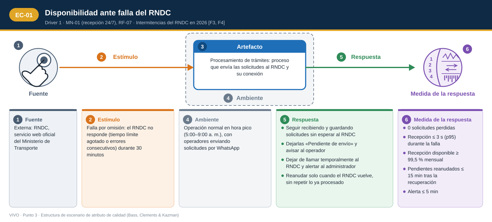

# EC-01 · Disponibilidad ante falla del RNDC

**Atributo:** Disponibilidad (driver 1)  
**Origen en el problema:** MN-01 (recepción 24/7), RF-07, episodios de intermitencia y contingencia del RNDC en 2026 [F3, F4].

## Escenario concreto

> Durante la hora pico de despachos, el RNDC deja de responder por 30 minutos. VIVO sigue recibiendo y registrando todas las solicitudes, informa al operador que su trámite está pendiente y lo completa automáticamente cuando el RNDC se recupera, sin perder ninguna solicitud.

## Partes del escenario

| Parte | Descripción |
|---|---|
| **Fuente del estímulo** | RNDC: servicio web oficial del Ministerio de Transporte, externo a VIVO. |
| **Estímulo** | El RNDC deja de responder (tiempo límite agotado o errores consecutivos) durante 30 minutos. |
| **Artefacto** | Procesamiento de trámites ante el RNDC: el proceso que envía las solicitudes y su conexión con el servicio web. |
| **Ambiente** | Operación normal en hora pico (5:00–9:00 a. m.), con operadores enviando solicitudes por WhatsApp. |
| **Respuesta** | VIVO: (1) sigue recibiendo y guardando solicitudes nuevas sin esperar al RNDC; (2) las deja en estado «Pendiente de envío»; (3) deja de llamar temporalmente al RNDC para no saturarlo; (4) informa al operador que su solicitud quedó registrada y pendiente; (5) reanuda el envío automáticamente cuando el RNDC vuelve, sin reenviar lo que ya se había procesado; (6) alerta al administrador. |
| **Medida de la respuesta** | • 0 solicitudes recibidas se pierden. • Confirmación de recepción al operador en ≤ 3 s (p95) durante la falla. • Recepción disponible ≥ 99,5 % mensual, medida aparte de la disponibilidad del RNDC. • Pendientes reanudados en ≤ 15 min después de que el RNDC se recupera. • Alerta al administrador en ≤ 5 min desde el inicio de la falla. • 0 solicitudes marcadas como «Emitida» sin confirmación oficial. |
