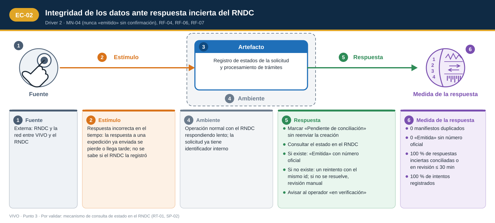

# EC-02 · Integridad de los datos ante una respuesta incierta del RNDC

**Atributo:** Integridad de los datos (driver 2)  
**Origen en el problema:** MN-04 (nunca reportar «emitido» sin confirmación), RF-04, RF-06, RF-07. Según la nota de 1.9, el error más costoso es perder o duplicar una solicitud o reportar un estado falso.

## Escenario concreto

> VIVO envía al RNDC la solicitud de expedición de un manifiesto, pero la respuesta no llega: se agota el tiempo de espera. No se sabe si el RNDC alcanzó a registrarlo. VIVO no reenvía a ciegas: verifica primero en el RNDC y solo entonces decide. Así evita un manifiesto duplicado o un estado falso.

## Partes del escenario

| Parte | Descripción |
|---|---|
| **Fuente del estímulo** | RNDC y la red entre VIVO y el RNDC (externos a VIVO). |
| **Estímulo** | La respuesta a una solicitud de expedición ya enviada se pierde o llega fuera del tiempo límite. El resultado real es desconocido. |
| **Artefacto** | Registro de estados de la solicitud y procesamiento de trámites ante el RNDC. |
| **Ambiente** | Operación normal, con el RNDC respondiendo lento. La solicitud ya tiene un identificador interno asignado. |
| **Respuesta** | VIVO: (1) marca la solicitud como «Pendiente de conciliación» y **no** reenvía la creación; (2) consulta el estado en el RNDC usando la referencia de la solicitud; (3) si el manifiesto existe, registra «Emitida» con el número oficial como evidencia; (4) si no existe, reintenta una sola vez con el mismo identificador interno; (5) si no se resuelve, pasa el caso a revisión manual; (6) informa al operador «en verificación», nunca «emitido» sin confirmación. |
| **Medida de la respuesta** | • 0 manifiestos duplicados ante el RNDC. • 0 solicitudes en estado «Emitida» sin número oficial del RNDC. • 100 % de las respuestas inciertas se concilian o pasan a revisión manual en ≤ 30 min. • 100 % de los intentos quedan registrados con fecha, resultado e identificador interno. |

> **Por validar:** el mecanismo exacto para consultar en el RNDC si una operación ya fue registrada, y qué referencia acepta (RT-01, SP-02).
