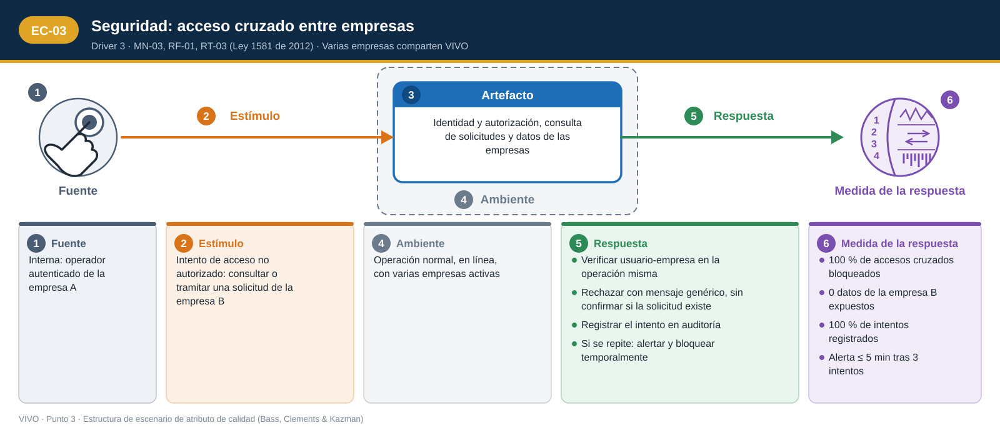

# EC-03 · Seguridad: acceso cruzado entre empresas

**Atributo:** Seguridad (driver 3)  
**Origen en el problema:** MN-03, RF-01, RT-03 (Ley 1581 de 2012). Varias empresas comparten VIVO, y el número de WhatsApp no prueba por sí solo que alguien pueda actuar por una empresa.

## Escenario concreto

> Un operador de la empresa A, desde su WhatsApp registrado, intenta consultar o tramitar un manifiesto de la empresa B. VIVO lo bloquea sin revelar ningún dato de la empresa B, registra el intento y, si se repite, alerta al administrador.

## Partes del escenario

| Parte | Descripción |
|---|---|
| **Fuente del estímulo** | Operador autenticado de la empresa A (usuario interno con acceso legítimo a VIVO, pero no a la empresa B). |
| **Estímulo** | Intenta consultar el estado o enviar una operación sobre una solicitud que pertenece a la empresa B, por ejemplo escribiendo su identificador. |
| **Artefacto** | Control de identidad y autorización, consulta de solicitudes y datos almacenados de las empresas. |
| **Ambiente** | Operación normal, en línea, con varias empresas activas. |
| **Respuesta** | VIVO: (1) verifica la asociación usuario-empresa en la operación misma, no solo al entrar; (2) rechaza la operación; (3) responde con un mensaje genérico que no confirma si la solicitud existe; (4) registra el intento en la auditoría; (5) si hay intentos repetidos, alerta al administrador y puede bloquear temporalmente al usuario. |
| **Medida de la respuesta** | • 100 % de los intentos de acceso cruzado son bloqueados. • 0 datos de la empresa B expuestos, ni siquiera si la solicitud existe. • 100 % de los intentos registrados con actor, empresa, operación, fecha-hora y resultado. • Alerta al administrador en ≤ 5 min después de 3 intentos fallidos del mismo usuario. |
