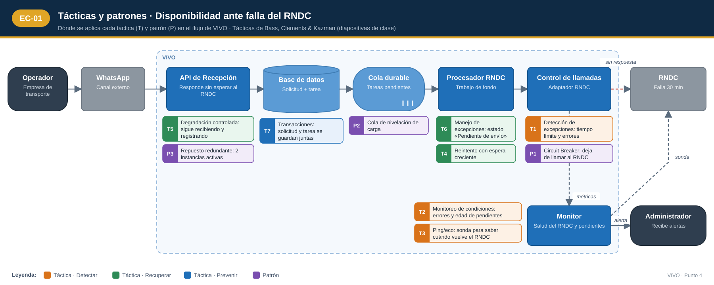

# Tácticas y patrones · Disponibilidad (EC-01)

**Escenario:** [EC-01 · Disponibilidad ante falla del RNDC](../03_Escenarios_de_Atributos_de_Calidad/EC-01_Disponibilidad.md)  
**Fuente:** tácticas de disponibilidad de Bass, Clements & Kazman (diapositivas *QA-Availability*): **detectar**, **recuperar** y **prevenir** fallas. Patrones *Circuit Breaker* y *Redundant Spare* de las mismas diapositivas, y *Queue-Based Load Leveling* del catálogo *Cloud Design Patterns* de Microsoft.

## Descripción

El RNDC es un defecto **externo**: VIVO no puede evitar que falle, pero sí puede evitar que esa falla se convierta en una falla **visible** para el operador. La estrategia es:

1. **Detectar** rápido que el RNDC no responde.
2. **Cortar** las llamadas para no quedar bloqueados ni saturarlo.
3. **Seguir recibiendo** solicitudes y dejarlas pendientes.
4. **Reanudar solo** cuando el RNDC vuelve.

## Diagrama

## Explicación y justificación

| ID | Táctica / patrón | Categoría | Dónde se aplica | Justificación (por qué ayuda a la medida de EC-01) |
|---|---|---|---|---|
| T1 | **Detección de excepciones** (tiempo límite y errores) | Detectar | Control de llamadas | Sin un tiempo límite, cada llamada al RNDC caído queda colgada y consume recursos. Detectar en segundos permite actuar antes de que la falla se propague. |
| T2 | **Monitoreo de condiciones** (*Monitor*) | Detectar | Monitor | Vigila la tasa de errores del RNDC y la edad de las solicitudes pendientes, y genera la **alerta en ≤ 5 min**. |
| T3 | **Ping/eco** (sonda de salud) | Detectar | Monitor → RNDC | Una consulta liviana periódica indica cuándo vuelve el RNDC, para **reanudar en ≤ 15 min** sin esperar a que entre una solicitud real. |
| T4 | **Reintento** (*Retry*) con espera creciente | Recuperar | Procesador RNDC | Las fallas transitorias se resuelven solas. Esperar cada vez más entre intentos evita saturar al RNDC cuando se está recuperando. |
| T5 | **Degradación controlada** (*Graceful degradation*) | Recuperar | API de Recepción | Es la táctica central: VIVO pierde solo la función de **tramitar**, pero conserva la de **recibir y registrar**. Así se cumple **0 solicitudes perdidas** y **recepción ≤ 3 s**. |
| T6 | **Manejo de excepciones** | Recuperar | Procesador RNDC | Ante la falla, la solicitud pasa a «Pendiente de envío» y se informa al operador el estado real, en lugar de un error genérico. |
| T7 | **Transacciones** | Prevenir | Base de datos | La solicitud y su tarea se guardan juntas o no se guardan: no puede quedar una solicitud aceptada sin tarea para procesarla. |
| P1 | **Circuit Breaker** | Patrón | Control de llamadas | Después de varios errores seguidos deja de llamar al RNDC por un tiempo y devuelve el control de inmediato. Evita reintentos infinitos y la falla en cascada (diapositivas; Fowler; Microsoft). |
| P2 | **Cola de nivelación de carga** (*Queue-Based Load Leveling*) | Patrón | Cola durable | Separa la recepción del trámite: las solicitudes se acumulan en la cola mientras el RNDC no está, y se procesan a un ritmo controlado cuando vuelve. |
| P3 | **Repuesto redundante** (*Redundant Spare*, activo) | Patrón | API de Recepción | Dos instancias de la API atienden a la vez. Si una falla, la otra sigue recibiendo. Cubre la meta de **recepción ≥ 99,5 %**, que depende de VIVO mismo y no del RNDC. |

## Posibles trade-offs

| Decisión | Lo que ganamos | Lo que sacrificamos |
|---|---|---|
| Procesamiento diferido con cola (P2, T5) | La recepción no depende del RNDC. | **Consistencia eventual:** el operador recibe «pendiente» y no el resultado final de inmediato. Hay que operar una cola. |
| Circuit Breaker (P1) | No hay fallas en cascada ni recursos bloqueados. | Hay que **calibrar los umbrales**. Si son agresivos, cortan llamadas que sí habrían funcionado; si son laxos, tardan en proteger. |
| Reintentos (T4) | Se recuperan las fallas transitorias. | Pueden **duplicar** operaciones si no son idempotentes. Esto se resuelve con las tácticas de [EC-02](Tacticas_Integridad_de_los_Datos.md). |
| Tiempo límite corto (T1) | Se detecta rápido. | Una respuesta lenta pero válida se trata como falla y genera resultados inciertos. |
| Repuesto redundante (P3) | Mayor disponibilidad de la recepción. | **Más costo** de infraestructura y necesidad de un balanceador. |
| Monitor y sonda (T2, T3) | Visibilidad y reanudación automática. | Más componentes que operar, y la sonda debe respetar los límites de consulta del RNDC (RT-04). |
