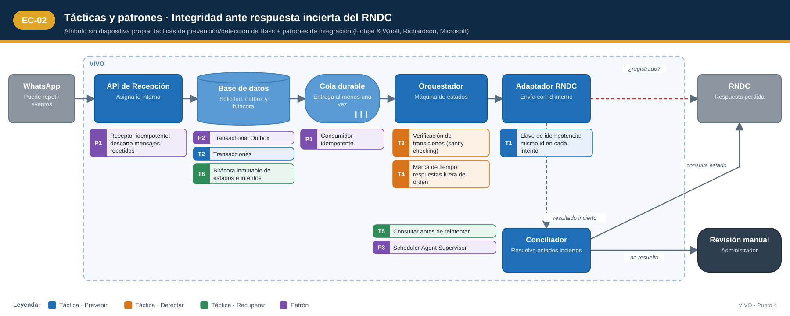

# Tácticas y patrones · Integridad de los datos (EC-02)

**Escenario:** [EC-02 · Integridad de los datos ante una respuesta incierta del RNDC](../03_Escenarios_de_Atributos_de_Calidad/EC-02_Integridad_de_los_Datos.md)

> **Nota sobre las fuentes:** la integridad de los datos no tiene una sesión propia en las diapositivas de clase. Por eso combinamos:
> - **Tácticas de Bass, Clements & Kazman** que sí vimos y que protegen la consistencia del estado: *transacciones*, *sanity checking* y *timestamp* (de las tácticas de disponibilidad para prevenir y detectar fallas).
> - **Patrones de la literatura de arquitectura e integración:**
>   - *Idempotent Receiver*: Hohpe & Woolf, *Enterprise Integration Patterns*, 2003.
>   - *Transactional Outbox*: Richardson, *Microservices Patterns*, 2018.
>   - *Scheduler Agent Supervisor* y la guía del patrón *Retry*: Microsoft, *Cloud Design Patterns*.

## Descripción

Cuando el RNDC no responde, VIVO **no sabe** si el manifiesto quedó registrado. Hay dos errores posibles, ambos graves:

- **Reintentar a ciegas** puede crear un manifiesto duplicado.
- **Suponer que se emitió** puede hacer que un camión salga sin manifiesto válido.

La estrategia es:

1. **Prevenir** duplicados dando a cada solicitud una identidad estable.
2. **Detectar** estados inválidos o fuera de orden.
3. **Recuperar** la verdad consultando al RNDC antes de reintentar.
4. Dejar **evidencia** de cada paso.

## Diagrama

## Explicación y justificación

| ID | Táctica / patrón | Categoría | Dónde se aplica | Justificación (por qué ayuda a la medida de EC-02) |
|---|---|---|---|---|
| T1 | **Llave de idempotencia** (mismo id interno en cada intento) | Prevenir | Adaptador RNDC | Cada envío al RNDC lleva el identificador interno de la solicitud. Si se repite, se reconoce como la misma operación y no como una nueva. Es la base de **0 manifiestos duplicados**. |
| T2 | **Transacciones** | Prevenir | Base de datos | El cambio de estado y el registro del intento se guardan juntos. Nunca queda un estado sin su evidencia. |
| T3 | **Verificación de transiciones** (*sanity checking*) | Detectar | Orquestador | La solicitud sigue una máquina de estados. Solo se permite pasar a «Emitida» desde «En trámite» y con número oficial. Una transición inválida se rechaza: **0 «Emitida» sin número oficial**. |
| T4 | **Marca de tiempo** (*timestamp*) | Detectar | Orquestador | Detecta respuestas tardías o fuera de orden, por ejemplo una respuesta vieja que llega después de una conciliación, y evita que sobrescriban un estado más reciente. |
| T5 | **Consultar antes de reintentar** | Recuperar | Conciliador | Ante una respuesta incierta, primero se pregunta al RNDC si la operación existe. Solo si no existe se reintenta, una vez y con el mismo id. Cumple **conciliación en ≤ 30 min o revisión manual**. |
| T6 | **Bitácora inmutable** de estados e intentos | Recuperar | Base de datos | Registro de solo-agregar: no se edita ni se borra. Permite reconstruir qué pasó y sirve de evidencia: **100 % de intentos registrados**. También apoya al driver de Trazabilidad. |
| P1 | **Receptor / consumidor idempotente** (*Idempotent Receiver*) | Patrón | API de Recepción y Cola | WhatsApp puede reenviar el mismo mensaje y la cola entrega «al menos una vez». El receptor recuerda los ids ya procesados y descarta los repetidos. |
| P2 | **Transactional Outbox** | Patrón | Base de datos → Cola | La solicitud y la tarea pendiente se guardan en la **misma transacción** de la base de datos. Un proceso aparte (*relay*) publica la tarea en la cola. Así no se pierde trabajo entre «guardar» y «publicar». |
| P3 | **Scheduler Agent Supervisor** | Patrón | Conciliador | Un supervisor revisa periódicamente las solicitudes en estados intermedios («En trámite», «Pendiente de conciliación») y decide: consultar, reintentar o pasar a revisión manual. |

## Posibles trade-offs

| Decisión | Lo que ganamos | Lo que sacrificamos |
|---|---|---|
| Consultar antes de reintentar (T5, P3) | No hay duplicados ni estados falsos. | **Más tiempo** hasta la emisión final y **dependencia** de que el RNDC permita consultar el estado (por validar, RT-01). |
| Máquina de estados estricta (T3) | Estados siempre válidos y explicables. | **Más lógica** y más casos que diseñar y probar. Los cambios del proceso exigen actualizar la máquina. |
| Transactional Outbox (P2) | No se pierde trabajo entre guardar y publicar. | Un proceso extra (*relay*) y **retraso** pequeño entre el guardado y la publicación. |
| Receptor idempotente (P1) | Los mensajes repetidos no generan solicitudes dobles. | Hay que **guardar y consultar** los ids procesados durante una ventana de tiempo, lo que implica almacenamiento y limpieza. |
| Bitácora inmutable (T6) | Evidencia completa. | **Crece sin parar:** se necesita una política de retención. |
| Revisión manual como último recurso | Ningún caso queda sin resolver. | **Carga operativa** para el administrador. |
