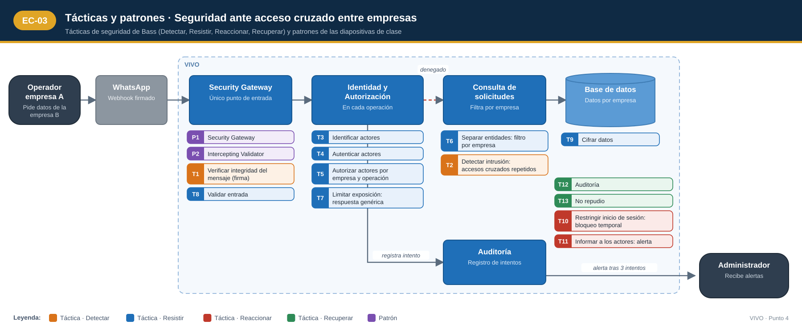

# Tácticas y patrones · Seguridad (EC-03)

**Escenario:** [EC-03 · Seguridad: acceso cruzado entre empresas](../03_Escenarios_de_Atributos_de_Calidad/EC-03_Seguridad.md)  
**Fuente:** tácticas de seguridad de Bass, Clements & Kazman (diapositivas *QA-Security*): **detectar**, **resistir**, **reaccionar** y **recuperarse** de ataques. Patrones *Security Gateway* e *Intercepting Validator* de las mismas diapositivas. Como referencia complementaria, el riesgo de este escenario es el primero de la lista *OWASP API Security Top 10* (2023): *Broken Object Level Authorization*, es decir, acceder a un objeto de otro usuario cambiando su identificador.

## Descripción

El atacante no es un extraño: es un **usuario legítimo** de la empresa A que intenta ver o tramitar algo de la empresa B. Por eso no basta con controlar la entrada. VIVO debe **verificar el permiso en cada operación y sobre cada solicitud**, filtrar siempre los datos por empresa, no revelar información en el rechazo, y **registrar y reaccionar** si el intento se repite.

## Diagrama

## Explicación y justificación

| ID | Táctica / patrón | Categoría | Dónde se aplica | Justificación (por qué ayuda a la medida de EC-03) |
|---|---|---|---|---|
| T1 | **Verificar la integridad del mensaje** | Detectar | Security Gateway | Se valida la firma de cada webhook de WhatsApp. Así nadie puede hacerse pasar por WhatsApp para inyectar mensajes falsos. |
| T2 | **Detectar intrusión** | Detectar | Consulta de solicitudes | Compara el patrón de uso con lo normal. Varios intentos de acceso a solicitudes ajenas en poco tiempo indican un abuso. |
| T3 | **Identificar actores** | Resistir | Identidad y Autorización | Asocia el número de WhatsApp a un usuario registrado y a su empresa. |
| T4 | **Autenticar actores** | Resistir | Identidad y Autorización | El número de WhatsApp no basta: el usuario se verifica al darse de alta (por ejemplo, con un código enviado por la empresa) y se revalida periódicamente. |
| T5 | **Autorizar actores** por empresa y operación | Resistir | Identidad y Autorización | Es la táctica central. En **cada** operación se verifica que la solicitud pertenezca a la empresa del usuario, y no solo al entrar. Así se cumple **100 % de accesos cruzados bloqueados**. |
| T6 | **Separar entidades** | Resistir | Consulta de solicitudes | Toda consulta lleva el filtro de empresa de forma obligatoria. Un error en la lógica no expone datos de otra empresa. |
| T7 | **Limitar la exposición** | Resistir | Identidad y Autorización | El rechazo usa un mensaje genérico, por ejemplo «no encontramos esa solicitud». No confirma si existe, lo que cumple **0 datos de la empresa B expuestos**. |
| T8 | **Validar la entrada** | Resistir | Security Gateway | Se limpia y valida lo que llega por el chat antes de procesarlo. |
| T9 | **Cifrar datos** | Resistir | Base de datos | Los datos personales se cifran en reposo y en tránsito (Ley 1581). |
| T10 | **Restringir inicio de sesión** | Reaccionar | Auditoría → Identidad | Tras 3 intentos de acceso cruzado, el usuario se bloquea temporalmente. |
| T11 | **Informar a los actores** | Reaccionar | Auditoría → Administrador | Se envía una alerta al administrador: **alerta en ≤ 5 min**. |
| T12 | **Auditoría** | Recuperar | Auditoría | Cada intento queda registrado con actor, empresa, operación, fecha-hora y resultado: **100 % de intentos registrados**. |
| T13 | **No repudio** | Recuperar | Auditoría | Los registros de auditoría no se pueden alterar, así que el usuario no puede negar lo que hizo. |
| P1 | **Security Gateway** | Patrón | Entrada de VIVO | Es el único punto de entrada. Centraliza la validación, la limitación de exposición, el cifrado en tránsito y el monitoreo, y los servicios internos nunca quedan expuestos. |
| P2 | **Intercepting Validator** | Patrón | Dentro del Gateway | Un elemento entre el origen y el destino que valida cada mensaje (firma, formato) antes de que llegue a la lógica de negocio. |

## Posibles trade-offs

| Decisión | Lo que ganamos | Lo que sacrificamos |
|---|---|---|
| Autorizar en cada operación (T5, T6) | Defensa en profundidad: un error en un punto no expone datos. | **Latencia** adicional en cada consulta y **más código** que revisar y probar. |
| Security Gateway (P1) | Un solo lugar para las políticas de seguridad. | Se vuelve un **punto único de falla**: hay que desplegarlo redundante. Además añade un salto de red, con su **costo en rendimiento** (diapositivas). |
| Intercepting Validator (P2) | Se rechazan mensajes falsos o malformados. | Costo en rendimiento y **mantenimiento**: las reglas de validación deben actualizarse. |
| Autenticación más fuerte (T4) | No basta con conocer un número. | **Fricción** para el operador y soporte cuando cambia de teléfono o pierde acceso. |
| Bloqueo temporal (T10) | Frena el abuso. | **Falsos positivos:** un usuario legítimo que se equivoca de número de solicitud puede quedar bloqueado. |
| Mensaje genérico (T7) | No se filtra información. | Al usuario honesto le cuesta más entender qué pasó, y el soporte debe revisar la auditoría. |
| Cifrado y auditoría inmutable (T9, T12, T13) | Cumplimiento legal y evidencia. | Más **gestión de llaves** y más almacenamiento. |
