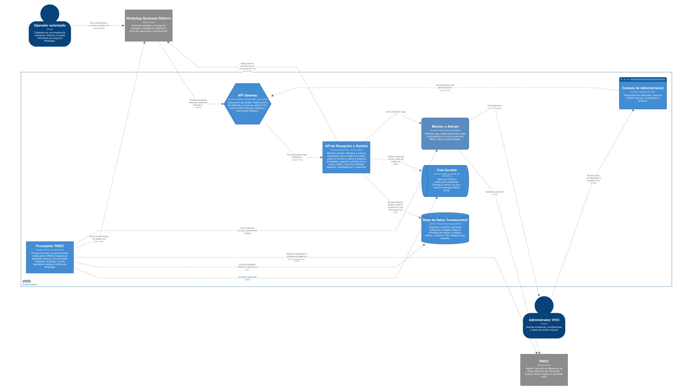

# C4 · Nivel 2 · Contenedores

**Vista en Structurizr:** `C2_Contenedores` (archivo [workspace.dsl](workspace.dsl)).

Este diagrama abre la caja de VIVO y muestra sus contenedores: cada aplicación o almacén de datos que se despliega por separado. Es el resultado de las cinco iteraciones de ADD ([5.2](../5.2_Iteraciones_ADD.md)).

*Imagen exportada desde Structurizr a partir de [workspace.dsl](workspace.dsl). Si se cambia el DSL, hay que volver a exportarla.*

## Contenedores

| Contenedor | Tecnología (familia) | Responsabilidad | Iteración ADD |
|---|---|---|---|
| **API Gateway** | Gateway de API gestionado o proxy inverso | Único punto de entrada. Valida la firma del webhook y la entrada, aplica TLS y limita el tráfico. | 4 |
| **API de Recepción y Gestión** | Aplicación web · monolito modular (2 instancias) | Identifica y autoriza al operador, guía la captura, asigna el id interno, aplica la máquina de estados y guarda la solicitud con su tarea (outbox). Descarta mensajes repetidos. | 1, 3, 4 |
| **Consola de Administración** | Aplicación web (SPA) | Seguimiento, revisión manual, conciliaciones y auditoría. | 1 |
| **Procesador RNDC** | Proceso de fondo (*worker*) | Consume tareas, tramita ante el RNDC con su adaptador (timeout, Circuit Breaker, reintentos, throttling), concilia resultados inciertos y notifica por WhatsApp. | 1, 2, 3 |
| **Base de Datos Transaccional** | Relacional (ACID) | Empresas, usuarios y permisos, solicitudes y estados, bitácora inmutable, outbox y auditoría, con filtro obligatorio por empresa. | 1, 3, 4 |
| **Cola Durable** | Broker de mensajes con persistencia | Tareas de trámite y notificación. Entrega al menos una vez y cola de mensajes fallidos (DLQ). | 1 |
| **Monitor y Alertas** | Plataforma de observabilidad | Métricas, logs, estado del circuito, edad de pendientes, sonda de salud del RNDC y alertas al administrador. | 5 |

## Relaciones

| Origen | Destino | Descripción | Tecnología |
|---|---|---|---|
| Operador autorizado | WhatsApp | Envía solicitudes y consulta el estado | Chat WhatsApp |
| WhatsApp | API Gateway | Entrega mensajes entrantes (webhook firmado) | HTTPS |
| Administrador VIVO | Consola de Administración | Revisa casos, conciliaciones y auditoría | HTTPS |
| Consola de Administración | API Gateway | Envía peticiones de administración | JSON/HTTPS |
| API Gateway | API de Recepción y Gestión | Enruta las peticiones validadas | JSON/HTTPS |
| API de Recepción y Gestión | Base de Datos | Guarda solicitud, estado, outbox y auditoría en una transacción | SQL |
| API de Recepción y Gestión | Cola Durable | Publica tareas de trámite (relay del outbox) | AMQP |
| API de Recepción y Gestión | WhatsApp | Responde los mensajes de la conversación | API HTTPS |
| Procesador RNDC | Cola Durable | Consume tareas | AMQP |
| Procesador RNDC | Base de Datos | Actualiza estados, intentos y bitácora | SQL |
| Procesador RNDC | RNDC | Solicita la expedición y consulta el estado | Servicio web autorizado · HTTPS |
| Procesador RNDC | WhatsApp | Envía notificaciones de estado | API HTTPS |
| API y Procesador | Monitor y Alertas | Envían métricas y logs | — |
| Monitor y Alertas | RNDC | Sondea la salud del servicio | HTTPS |
| Monitor y Alertas | Administrador VIVO | Envía alertas | Correo / mensajería |

## Cómo responde la estructura a los escenarios

- **EC-01 (Disponibilidad):** la API guarda y responde sin llamar al RNDC. El Procesador es el único que habla con el RNDC y corta las llamadas con el Circuit Breaker. La Cola guarda el trabajo pendiente.
- **EC-02 (Integridad):** la API guarda la solicitud y la tarea en una sola transacción (outbox). El Procesador usa el id interno como llave de idempotencia y concilia antes de reintentar.
- **EC-03 (Seguridad):** todo entra por el API Gateway. La API autoriza cada operación por empresa y registra los intentos en la auditoría de la Base de Datos.
