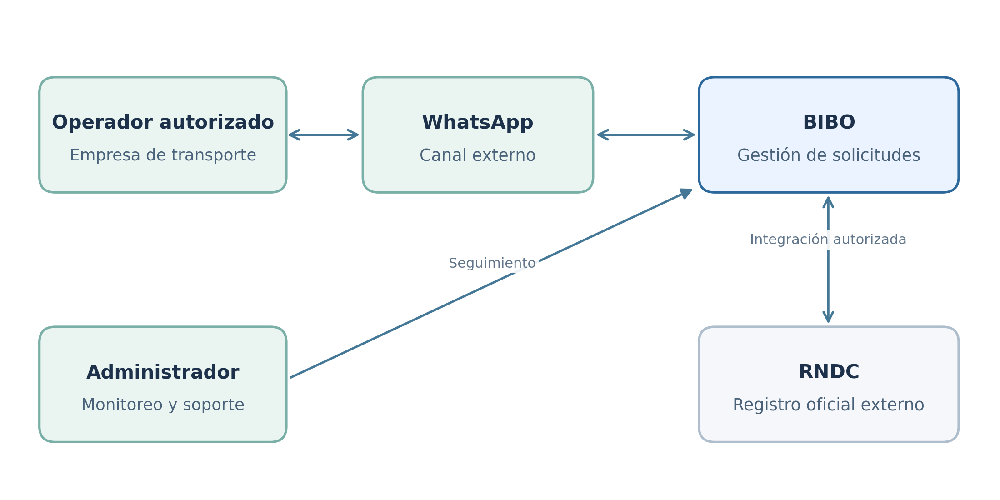
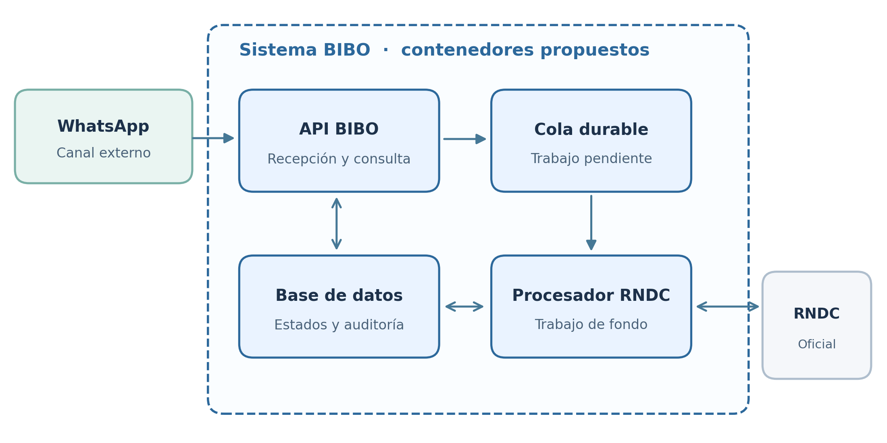
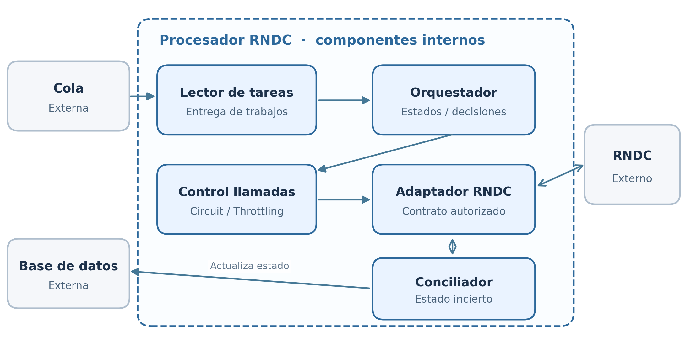

**PONTIFICIA UNIVERSIDAD JAVERIANA CALI**

Maestría en Ingeniería de Software Arquitectura de Software

**VIVO**

**Diseño de una arquitectura resiliente para la gestión de solicitudes de manifiestos electrónicos de carga mediante WhatsApp**

Proyecto del curso · Documento de arquitectura · Versión 1.0

Integrantes: Liza Cerinza·  Valentina Luna

Docente: Eduard Correa

1. Contexto del problema

1.1. Contexto y necesidad del negocio

En este trabajo, VIVO es la solución que proponemos para que las empresas de transporte gestionen sus solicitudes de manifiestos electrónicos de carga a través de WhatsApp. La necesidad surge de un proceso operativo que exige recopilar la información del viaje, verificar condiciones, tramitar la emisión por los mecanismos oficiales y avisar el resultado a quien hizo la solicitud. Lo que se espera del servicio es poder recibir solicitudes las 24 horas, sin que el usuario tenga que moverse entre varios sistemas.

La mayor dificultad de arquitectura es la dependencia de servicios externos. VIVO controla la recepción, el registro y el seguimiento de una solicitud, pero no la disponibilidad del Registro Nacional de Despachos de Carga (RNDC) ni las validaciones que este realiza. La documentación oficial indica que la empresa de transporte expide el manifiesto a través del RNDC y que existen canales de integración mediante servicios web. [F2, F5]

Se han reportado episodios de lentitud e intermitencia del RNDC. En mayo de 2026 el Ministerio explicó que la plataforma tuvo una afectación por solicitudes anómalas y, en septiembre de 2026, informó que activó un plan oficial de contingencia. Estos antecedentes muestran por qué la continuidad debe diseñarse sin suponer que el servicio externo siempre responde. [F3, F4]

1.2. Problema de arquitectura

¿Cómo lograr que VIVO reciba y administre solicitudes de manifiestos de forma segura y con tiempos de respuesta razonables, incluso cuando el RNDC o WhatsApp fallan, sin duplicar registros y sin atribuirse una emisión que todavía no está confirmada?

1.3. Actores y límites del sistema

| **Actor** | **Relación con** **VIVO** |
| --- | --- |
| Operador autorizado | Envía y consulta solicitudes desde WhatsApp en nombre de una empresa de transporte. |
| Empresa de transporte | Es responsable de la operación y de la expedición del manifiesto conforme a las reglas aplicables. |
| Administrador VIVO | Consulta incidencias, seguimiento y trazabilidad; no sustituye las autorizaciones de la empresa. |
| WhatsApp / proveedor | Transporta los mensajes y eventos del canal de atención; es una dependencia externa. |
| RNDC | Sistema oficial externo donde se registra y valida el manifiesto, según el procedimiento autorizado. |
1.4. Alcance y exclusiones

| **Incluye** | **No incluye** |
| --- | --- |
| Recepción de datos y validación inicial de la solicitud. | Gestión completa de flotas, rutas, GPS o costos de transporte. |
| Identificación del usuario y verificación de su empresa. | Facturación, cartera, pagos y suscripciones. |
| Registro, seguimiento y control de estados. | Reemplazar el RNDC o expedir documentos oficiales por cuenta propia. |
| Integración autorizada, manejo de fallas y conciliación. | Automatizar contingencias oficiales sin verificar su habilitación y procedimiento. |
| Notificación del resultado por WhatsApp. | Cubrir todos los trámites del RNDC fuera del manifiesto de carga. |
1.5. Flujo funcional resumido

1. Un operador autorizado inicia la solicitud por WhatsApp.

2. VIVO identifica al usuario, verifica su empresa y solicita los datos requeridos.

3. Registra la solicitud con un identificador propio y valida que esté completa.

4. Cuando corresponde, envía el trámite por un mecanismo autorizado del RNDC.

5. Registra el resultado: confirmado, rechazado, pendiente o pendiente de conciliación.

6. Informa al usuario el estado real. Solo presenta el manifiesto como emitido si existe confirmación oficial.

Límite importante: si el Ministerio activa un procedimiento oficial de contingencia, la empresa debe aplicar las reglas vigentes de ese procedimiento. VIVO no debe inventar una ruta alternativa ni generar por sí mismo un manifiesto oficial. [F4]

1.6. Requerimientos funcionales

| **ID** | **Requerimiento funcional** |
| --- | --- |
| RF-01 | Identificar al remitente y verificar su autorización para actuar por una empresa. |
| RF-02 | Capturar y validar los datos necesarios para preparar la solicitud. |
| RF-03 | Relacionar la solicitud con la empresa autorizada y los registros previos exigibles. |
| RF-04 | Guardar la solicitud y asignarle un identificador interno único. |
| RF-05 | Solicitar el trámite al RNDC exclusivamente por el mecanismo autorizado. |
| RF-06 | Consultar y actualizar el estado del trámite sin crear registros duplicados. |
| RF-07 | Administrar solicitudes pendientes durante fallas o respuestas inciertas. |
| RF-08 | Notificar por WhatsApp confirmaciones, rechazos y estados pendientes. |
| RF-09 | Conservar historial de cambios de estado, intentos y responsables. |
| RF-10 | Permitir a personal autorizado revisar casos que exigen atención manual. |
1.7. Restricciones, supuestos y datos por validar

| **Estado** | **Definición** |
| --- | --- |
| Confirmado por fuente externa | El RNDC es el sistema oficial y sus procesos incluyen validaciones y documentación técnica. La integración exige atender requisitos aplicables. [F2, F5] |
| Confirmado por fuente externa | El RNDC ha tenido episodios públicos de intermitencia; existe un plan oficial de contingencia que puede activarse. [F3, F4] |
| Supuesto de diseño | VIVO se plantea como un servicio de gestión de solicitudes mediante WhatsApp, con recepción 24/7. |
| Por validar | Acceso, credenciales, condiciones del servicio web vigente y permisos concretos para cada empresa. |
| Por validar | Volumen diario, usuarios concurrentes reales, presupuestos, disponibilidad contratada y retención de datos. |
| Restricción propuesta | No enviar solicitudes masivas ni reintentar sin control; evitar saturar la integración oficial. |
1.8. Métricas relevantes para el diseño

La guía del curso pide métricas. Como en esta versión no tenemos mediciones históricas de uso de VIVO, planteamos cargas de prueba y metas propuestas que habrá que revisar con datos del negocio antes de aprobar la arquitectura.

| **Indicador** | **Meta propuesta / forma de verificar** |
| --- | --- |
| Concurrencia | Simular 50 solicitudes simultáneas de recepción. Es una carga de prueba, no el volumen real. |
| Latencia de recepción | El 95 % de eventos recibidos por la API se registra y confirma internamente en ≤ 3 s, sin contar la entrega por WhatsApp. |
| Integridad | En pruebas de fallos controlados, 0 solicitudes confirmadas como recibidas se pierden y 0 manifiestos se marcan como emitidos sin evidencia. |
| Accesos no autorizados | 100 % de los intentos de prueba entre empresas se rechazan y generan registro de auditoría. |
| Continuidad | Medir por separado disponibilidad del canal de entrada VIVO y disponibilidad del RNDC; meta de servicio propia: por definir. |
| Otros indicadores | Solicitudes/día, porcentaje de rechazo, antigüedad de pendientes y tiempo de conciliación: línea base por levantar. |
2. Identificación de atributos de calidad

Clasificamos los atributos según su origen. Consideramos explícitos los asociados a la expectativa de servicio 24/7 y al uso de WhatsApp; los implícitos los deducimos de la naturaleza del trámite, de los datos que se manejan y de las dependencias externas. Esta clasificación es fruto de nuestro análisis del caso y no un levantamiento formal aprobado por un cliente.

| **Atributo** | **Origen** | **Razón** |
| --- | --- | --- |
| Disponibilidad | Explícito | Se espera recibir solicitudes durante todo el día, aun cuando falle una dependencia. |
| Desempeño | Implícito | La confirmación inicial no debería quedar bloqueada por la demora del RNDC. |
| Seguridad | Implícito | La información y las operaciones deben limitarse a cada empresa autorizada. |
| Interoperabilidad | Explícito | Es necesario intercambiar información con WhatsApp y con el sistema oficial. |
| Modificabilidad | Implícito | Las reglas o mecanismos del RNDC pueden evolucionar y la solución debe adaptarse. |
| Integridad / confiabilidad | Implícito | No se deben perder solicitudes aceptadas ni interpretar resultados inciertos como emisión. |
| Usabilidad | Explícito | La solicitud se hace por un canal familiar y requiere un flujo comprensible. |
| Recuperabilidad | Implícito | Las operaciones pendientes deben retomarse de forma controlada después de una interrupción. |
2.1. Los cinco atributos priorizados

| **Prioridad** | **Atributo** | **Justificación arquitectónica** |
| --- | --- | --- |
| 1 | Disponibilidad | Principal riesgo: interrupciones de un servicio externo que no controla VIVO. |
| 2 | Seguridad | Un acceso indebido permitiría consultar o tramitar información de otra empresa. |
| 3 | Desempeño | Se deben absorber solicitudes concurrentes y responder sin esperar el procesamiento oficial. |
| 4 | Interoperabilidad | El sistema depende de contratos de integración y validaciones externas. |
| 5 | Modificabilidad | Se requiere aislar los cambios de la integración sin alterar el proceso principal. |
La integridad y la trazabilidad no se descartan: las tratamos como restricciones obligatorias del diseño y atraviesan los escenarios de disponibilidad y seguridad. Así podemos priorizar cinco atributos sin dejar desprotegidos los datos de la operación.

3. Escenarios de atributos de calidad

Elegimos tres atributos con impacto directo en la estructura: disponibilidad, desempeño y seguridad. Cada escenario usa las seis partes vistas en clase, y sus métricas son criterios de aceptación propuestos para pruebas controladas.

EC-01. Disponibilidad ante falla del RNDC

| **Elemento** | **Descripción** |
| --- | --- |
| Fuente del estímulo | RNDC, servicio externo. |
| Estímulo | El servicio demora más que el tiempo límite configurado o devuelve errores consecutivos. |
| Artefacto | Procesador de solicitudes y adaptador RNDC de VIVO. |
| Ambiente | Operación normal con solicitudes ya aceptadas y una falla temporal externa. |
| Respuesta | VIVO conserva la solicitud, interrumpe temporalmente nuevas llamadas cuando corresponde, informa estado pendiente y reanuda con verificación de estado para evitar duplicidades. |
| Medida de respuesta | En una prueba de falla de 10 minutos, 0 solicitudes aceptadas se pierden; 0 se marcan como emitidas sin confirmación; la API de recepción mantiene su tiempo objetivo de ≤ 3 s en p95. |
EC-02. Desempeño durante solicitudes simultáneas

| **Elemento** | **Descripción** |
| --- | --- |
| Fuente del estímulo | Operadores autorizados que escriben por WhatsApp. |
| Estímulo | Ingresan 50 eventos válidos prácticamente al mismo tiempo. |
| Artefacto | API de entrada, almacenamiento y mecanismo de publicación a procesamiento. |
| Ambiente | Carga de prueba concurrente, RNDC lento pero sin caer completamente. |
| Respuesta | VIVO valida datos mínimos, persiste las solicitudes, responde con su identificador y procesa las operaciones oficiales de manera controlada. |
| Medida de respuesta | Al menos 95 % de eventos recibidos por la API queda registrado en ≤ 3 s; tasa de errores internos ≤ 1 %. La entrega al usuario por WhatsApp se mide aparte. |
EC-03. Seguridad entre empresas

| **Elemento** | **Descripción** |
| --- | --- |
| Fuente del estímulo | Usuario autenticado de una empresa A. |
| Estímulo | Intenta consultar o procesar un manifiesto asociado a una empresa B. |
| Artefacto | Control de identidad y autorización, API y repositorio de solicitudes. |
| Ambiente | Operación normal, con usuarios y empresas diferentes. |
| Respuesta | VIVO valida la asociación usuario-empresa, bloquea el acceso y registra el evento sin revelar datos de la otra empresa. |
| Medida de respuesta | 100 % de los casos de acceso cruzado ejecutados en pruebas son bloqueados; el 100 % registra actor, empresa, instante, operación y resultado. |
4. Tácticas y patrones

Las tácticas buscan modificar la respuesta de un atributo de calidad y los patrones agrupan soluciones recurrentes; las herramientas se escogerán más adelante. En la propuesta solo incluimos mecanismos que aportan a los escenarios definidos.

| **Escenario** | **Táctica / patrón** | **Aplicación y costo** |
| --- | --- | --- |
| EC-01 | Timeout y detección de fallas (tácticas) | Cerrar llamadas que no responden. Sacrificio: un límite agresivo puede tratar demoras como fallas. |
| EC-01 | Circuit Breaker (patrón) | Abrir el circuito después de errores repetidos y permitir recuperación controlada. Exige monitoreo y pruebas de umbrales. |
| EC-01 | Persistencia y reconciliación (decisión de diseño) | Guardar antes de confirmar recepción; ante resultado desconocido, consultar estado antes de reintentar. Aumenta lógica de estados. |
| EC-02 | Control de concurrencia / Throttling (táctica/patrón) | Regular la presión sobre el RNDC, respetando límites oficiales. Puede aumentar el tiempo total de emisión. |
| EC-02 | Separación de recepción y procesamiento (concepto de diseño) | La respuesta inicial no espera la operación externa. Exige administrar tareas pendientes. |
| EC-03 | Autenticación y autorización (tácticas) | Comprobar identidad y vínculo con empresa para cada operación. Requiere mantener permisos actualizados. |
| EC-03 | Security Gateway (patrón, opción lógica) | Aplicar controles de ingreso uniformes sin reemplazar la autorización dentro de cada operación. |
| EC-03 | Cifrado y auditoría (tácticas) | Reducir exposición de datos, proteger credenciales y registrar decisiones de acceso; añade operación y manejo de secretos. |
4.1. Relación entre medidas y validación

| **Decisión** | **Cómo se prueba** |
| --- | --- |
| Circuit Breaker | Simular timeouts y errores del RNDC, observar apertura, recuperación y ausencia de pérdidas. |
| Separación de procesamiento | Cargar 50 entradas y medir p95 del registro antes de que termine la tarea externa. |
| Control de acceso | Ejecutar pruebas de usuario de empresa A sobre solicitudes de empresa B. |
| No duplicación | Simular respuesta ambigua, reenvío de mensajes y reintento; comprobar identificador y resultado único. |
5. Diseño de arquitectura mediante ADD

5.1. Drivers de arquitectura (máximo cinco)

| **ID** | **Driver** | **Efecto sobre el diseño** |
| --- | --- | --- |
| D-01 | Continuidad de recepción | Desacoplar entrada del RNDC y conservar solicitudes aceptadas. |
| D-02 | Acceso segregado por empresa | Autorizar usuarios y operaciones con datos asociados a una empresa. |
| D-03 | Tiempo de confirmación inicial | Evitar bloquear la API por llamadas externas y controlar concurrencia. |
| D-04 | Dependencia contractual del RNDC | Aislar protocolos, límites y cambios en un adaptador dedicado. |
| D-05 | Integridad del estado de emisión | Mantener estados verificables, trazabilidad y mecanismos contra duplicación. |
5.2. Aplicación resumida de ADD

| **Iteración** | **Decisión de descomposición** | **Razón** |
| --- | --- | --- |
| 1. Sistema | Separar canal de entrada, gestión de solicitudes, procesamiento del RNDC y persistencia. | Los fallos del tercero no deben bloquear todas las funciones. |
| 2. Procesamiento | Diseñar un proceso de fondo independiente del receptor, con cola persistente. | Absorber solicitudes y controlar su ritmo de procesamiento. |
| 3. Integración | Aislar adaptador RNDC, control de llamadas y conciliación. | Cambios del servicio externo y resultados inciertos se gestionan en un solo límite. |
| 4. Seguridad y datos | Comprobar empresa para cada operación y persistir historial auditable. | Evitar accesos cruzados y mantener una fuente confiable de estados. |
| 5. Evaluación | Revisar escenarios EC-01 a EC-03 y riesgos R-01 a R-09. | Comprobar que la estructura satisface las medidas propuestas. |
5.3. Conceptos de diseño y alternativa seleccionada

Proponemos un monolito modular para la lógica de negocio, junto con un proceso de fondo para las integraciones y una cola persistente. Esto no significa dividir todo en microservicios: un mismo equipo puede mantener una sola base de código con límites internos claros y dos procesos desplegables cuando haga falta.

| **Alternativa** | **Ventajas** | **Limitaciones / decisión** |
| --- | --- | --- |
| Procesamiento totalmente síncrono | Implementación inicial simple. | La recepción queda atada al RNDC. Se descarta para el proceso crítico. |
| Monolito modular + proceso de fondo | Separación suficiente para disponibilidad, operación y evolución gradual. | Requiere cola, trazabilidad y monitoreo. Se selecciona para esta versión. |
| Microservicios independientes | Mayor independencia de equipos y despliegue, si el sistema crece. | Más infraestructura, operación y fallas distribuidas. No se justifica con los datos disponibles. |
Dejamos los límites técnicos sin proveedor definido. La decisión de arquitectura es conservar los estados, desacoplar los procesos, controlar los accesos e integrar de forma autorizada; elegir una nube, un framework o un producto concreto no es necesario para justificar este diseño.

5.4. Arquitectura refinada: modelo C4

C4 - Nivel 1. Contexto del sistema

Figura 1. Contexto: actores y sistemas externos de VIVO.

En el nivel de contexto, VIVO administra solicitudes y resultados. WhatsApp funciona como canal y el RNDC conserva la autoridad sobre el registro oficial. La empresa transportadora mantiene las responsabilidades que le corresponden.

C4 - Nivel 2. Contenedores

Figura 2. Contenedores propuestos dentro del límite VIVO.

La API recibe y registra; la base de datos guarda solicitudes, identidades y auditoría; la cola entrega tareas persistentes y el procesador realiza las integraciones de forma controlada. El diseño permite operar dentro de un mismo proyecto y separar procesos sin exigir microservicios.

C4 - Nivel 3. Componentes del procesador RNDC

Figura 3. Componentes internos del contenedor de procesamiento RNDC.

El lector de tareas inicia el trabajo y el orquestador maneja los estados. El control de llamadas aplica timeout, Circuit Breaker y límites de ritmo, el adaptador traduce el contrato externo y el conciliador investiga los resultados inciertos antes de intentar crear una operación nueva.

5.5. Modelo de estados y datos clave

| **Estado** | **Significado** |
| --- | --- |
| Recibida | VIVO guardó la solicitud y devolvió su identificador. |
| En validación | Se verifica que el usuario, la empresa y los datos cumplan condiciones. |
| Pendiente de envío | Está lista para una operación autorizada, pero aún no se ha enviado. |
| En trámite | Se inició la operación externa; resultado final todavía no confirmado. |
| Pendiente de conciliación | La respuesta es desconocida; no se debe enviar automáticamente una segunda creación. |
| Emitida | Existe evidencia de confirmación oficial y referencia identificable. |
| Rechazada / atención manual | El servicio externo rechazó el trámite o requiere revisión humana. |
Proponemos como entidades mínimas: Empresa, UsuarioEmpresa, Solicitud, HistorialEstado, IntentoIntegracion y ReferenciaOficial. Cada solicitud tendrá un identificador interno, empresa, usuario, marca temporal, estado y una referencia de correlación. Solo los resultados confirmados llevarán información de emisión oficial. La política de retención y el contenido exacto deben validarse con el responsable jurídico y operativo.

5.6. Comportamiento ante fallas

RNDC no responde: se registra el error, se controla el número de intentos y la solicitud mantiene su estado real.

Respuesta externa incierta: se detiene la repetición de creación hasta confirmar por consulta o revisión autorizada si existe un registro.

WhatsApp no entrega la notificación: el estado queda disponible en VIVO y se agenda un aviso posterior; una notificación fallida no anula el trámite oficial.

Base de datos o cola no disponibles: VIVO no promete aceptación definitiva hasta persistir la solicitud; se informa un error de recepción y se habilita reenvío seguro.

Contingencia oficial: se comunica al operador la ruta vigente definida por la autoridad, sin que VIVO asuma habilitaciones no comprobadas.

6. Decisiones de arquitectura (ADR)

Documentamos cinco decisiones propuestas. Su estado es «Propuesto» porque este documento es una versión académica para revisión y no demuestra una aprobación empresarial ni una implementación.

6.1. ADR-001 - Estructura modular con procesador separado

**1. Título.** Diseñar VIVO como un monolito modular de negocio y un proceso separado para trámites RNDC.

**2. Estado.** Propuesto. Fecha: 21 de noviembre de 2026. Aprobación por comité: pendiente.

**3. Contexto.** El servicio requiere responsabilidades claras, pero no hay evidencia de múltiples equipos ni escala que justifique microservicios. Alternativas: aplicación síncrona única, monolito modular con proceso de fondo y microservicios completos.

**4. Decisión.** Seleccionar monolito modular y proceso de fondo, con contratos internos definidos y despliegues coordinados. Mantener libertad tecnológica.

**5. Consecuencias.** Beneficio: menor complejidad que microservicios y aislamiento de trabajo externo. Costo: hay que gestionar dos procesos y posibles cambios coordinados. Revisar si volumen o equipos crecen.

**6. Cumplimiento.** Revisar dependencias entre módulos, pruebas de contrato internas, monitoreo de dos procesos y evaluación de EC-01/EC-02 antes de producción.

**7. Notas.** Relación: D-01, D-03, D-04; Figura 2. Autor y aprobación: por definir.

6.2. ADR-002 - Recepción persistente y procesamiento diferido

**1. Título.** Confirmar la recepción solamente después de almacenar la solicitud y entregar el trámite al procesamiento diferido.

**2. Estado.** Propuesto. Fecha: 21 de noviembre de 2026. Aprobación por comité: pendiente.

**3. Contexto.** Si la API espera al RNDC, una falla externa afecta al usuario y puede agotar la capacidad de recepción. Alternativas: procesamiento síncrono y procesamiento desacoplado con cola durable.

**4. Decisión.** Usar almacenamiento transaccional y una cola persistente para activar el trabajo. Definir mecanismo que evite la pérdida entre persistir y publicar (por ejemplo, registro de salida pendiente).

**5. Consecuencias.** Beneficio: la recepción no depende de la emisión externa. Costos: cola, reintentos, estados y operación. Riesgo: mensajes repetidos o desordenados.

**6. Cumplimiento.** Probar interrupción entre guardado y publicación, reentrega de tareas, carga concurrente y recuperación sin pérdida en casos controlados.

**7. Notas.** Relación: D-01, D-03, D-05; EC-01 y EC-02. Responsable técnico: por definir.

6.3. ADR-003 - Adaptador RNDC con control de fallas y ritmo

**1. Título.** Aislar toda comunicación oficial detrás de un adaptador con timeout, Circuit Breaker y Throttling.

**2. Estado.** Propuesto. Fecha: 21 de noviembre de 2026. Aprobación por comité: pendiente.

**3. Contexto.** RNDC es una dependencia que puede responder lentamente y aplica controles a solicitudes; no se debe trasladar su protocolo a toda la aplicación. Alternativas: llamadas directas desde distintos módulos o adaptador central.

**4. Decisión.** Usar un único adaptador configurable para operaciones autorizadas y un control de llamadas. No fijar valores de umbral hasta hacer pruebas y verificar condiciones del RNDC.

**5. Consecuencias.** Beneficio: limita fallas en cascada y concentra cambios externos. Costo: puede aumentar la espera y requiere configuración y monitoreo. Riesgo: cortar llamadas útiles.

**6. Cumplimiento.** Validar apertura y recuperación del circuito, límites de solicitudes, errores y cumplimiento de contratos oficiales; vigilar tasas de timeout y rechazo.

**7. Notas.** Relación: D-01, D-04; EC-01 y EC-02; Figura 3. Especificación externa por validar.

6.4. ADR-004 - Autorización por empresa y operación

**1. Título.** Exigir identidad comprobada y autorización explícita para cada consulta o gestión de solicitud.

**2. Estado.** Propuesto. Fecha: 21 de noviembre de 2026. Aprobación por comité: pendiente.

**3. Contexto.** El número de WhatsApp no demuestra por sí solo que el remitente pueda actuar por una empresa. Alternativas: confiar solo en el número o mantener una asociación usuario-empresa con verificación.

**4. Decisión.** Aplicar autenticación adecuada al canal y comprobar permisos dentro de cada operación, además del filtro de entrada. Guardar auditoría sin exponer documentos en registros de error.

**5. Consecuencias.** Beneficio: reduce accesos cruzados y mejora trazabilidad. Costo: administración de identidades, autorizaciones y soporte por pérdida de acceso.

**6. Cumplimiento.** Ejecutar pruebas entre empresas, revocación de permisos, cambios de rol, revisión de logs y protección de secretos.

**7. Notas.** Relación: D-02, EC-03; fuente de identidad y proceso de alta por definir.

6.5. ADR-005 - Identificador interno, estados verificables y conciliación

**1. Título.** Evitar tratar una solicitud repetida o respuesta ambigua como una nueva emisión confirmada.

**2. Estado.** Propuesto. Fecha: 21 de noviembre de 2026. Aprobación por comité: pendiente.

**3. Contexto.** WhatsApp puede entregar eventos repetidos y el RNDC puede registrar una operación antes de fallar la respuesta. Reenviar a ciegas puede producir inconsistencias. Alternativas: reintento inmediato o control de duplicados y conciliación.

**4. Decisión.** Asignar un identificador interno estable, registrar intentos, correlacionar respuestas y exigir confirmación oficial para pasar a «Emitida». Ante resultado incierto se concilia antes de reintentar.

**5. Consecuencias.** Beneficio: reduce riesgos de registros duplicados y de estados falsos. Costo: más lógica y casos manuales; puede aumentar el tiempo de resolución.

**6. Cumplimiento.** Probar reenvío de mensaje, respuesta perdida, respuesta tardía y operación repetida; comprobar unicidad interna y evidencia oficial de emisión.

**7. Notas.** Relación: D-05, EC-01; validación del identificador externo por definir.

7. Análisis de riesgos de arquitectura

7.1. Criterio de evaluación

La matriz usa probabilidad (P) e impacto (I) en una escala de 1 a 3: 1 bajo, 2 medio y 3 alto. Nivel = P × I; 1-2 es bajo, 3-4 medio y 6-9 alto. La valoración es cualitativa e inicial, y no parte de incidentes medidos de VIVO.

7.2. Matriz de evaluación de riesgos

| **ID** | **Riesgo y componente** | **P / I / Nivel** | **Mitigación** |
| --- | --- | --- | --- |
| R-01 | Falla prolongada RNDC D-01 / adaptador | 3 / 3 / 9 Alto | Circuit Breaker, cola durable, estado pendiente, revisión del procedimiento oficial de contingencia. |
| R-02 | Duplicación o resultado incierto D-05 / conciliador | 2 / 3 / 6 Alto | Identificador estable, consulta de estado antes de reintentar, auditoría y revisión manual. |
| R-03 | Consulta de otra empresa D-02 / autorización | 2 / 3 / 6 Alto | Autorización por empresa y prueba de acceso cruzado en cada operación. |
| R-04 | Pérdida de solicitudes aceptadas D-01 / BD y cola | 2 / 3 / 6 Alto | Persistencia antes de confirmar, mecanismo de salida fiable, respaldos y pruebas de recuperación. |
| R-05 | Interrupción del canal WhatsApp D-01 / canal externo | 2 / 2 / 4 Medio | Conservar estado independiente, reintento de notificación y ruta de atención alternativa definida. |
| R-06 | Cambio en contrato RNDC D-04 / adaptador | 2 / 2 / 4 Medio | Aislar adaptador, versionar contrato y ejecutar pruebas de integración. |
| R-07 | Pico de solicitudes D-03 / entrada y proceso | 2 / 2 / 4 Medio | Control de concurrencia, cola y prueba con 50 entradas simultáneas. |
| R-08 | Exposición de credenciales D-02 / integración | 2 / 3 / 6 Alto | Gestión de secretos, mínimo privilegio, rotación y revisión de accesos. |
| R-09 | Uso incorrecto de contingencia D-04 / operación | 2 / 3 / 6 Alto | Revisión jurídica/operativa del plan vigente; procedimiento manual autorizado y capacitación. |
7.3. Gestión y revisión de riesgos

Priorizamos mitigar los riesgos altos antes de conectar operaciones reales. El responsable de arquitectura verifica el diseño; operación y seguridad validan el monitoreo y los controles; y el responsable legal/operativo de transporte confirma los procedimientos oficiales. Los roles concretos deben asignarse en el proyecto. La probabilidad e impacto residuales se reestimarán después de las pruebas controladas: no los damos por reducidos sin evidencia.

| **Acción** | **Criterio de cierre propuesto** |
| --- | --- |
| Prueba de falla RNDC | Solicitud aceptada no se pierde ni pasa a emitida sin confirmación. |
| Prueba de duplicidad | Reenvíos, respuestas ambiguas y reintentos no crean una segunda operación no controlada. |
| Prueba de seguridad | Accesos cruzados entre empresas se rechazan y auditan. |
| Revisión normativa y operativa | Integración, roles y tratamiento de contingencia aprobados por responsables competentes. |
| Revisión de capacidad | Métricas EC-02 medidas con registros de prueba y umbrales revisados. |
8. Evaluación de arquitectura ante el comité

Proponemos una presentación de 20 minutos como máximo. El objetivo es mostrar cómo las decisiones estructurales atienden los drivers y qué compromisos introducen, no describir tecnología sin justificarla.

8.1. Estructura de sustentación (20 minutos)

| **Lámina** | **Contenido** | **Tiempo** |
| --- | --- | --- |
| 1 | Problema, actores y alcance | 2 min |
| 2 | Requerimientos y métricas propuestas | 2 min |
| 3 | Cinco drivers y atributos de calidad | 3 min |
| 4 | Tres escenarios con sus medidas | 3 min |
| 5 | C4: contexto y contenedores | 3 min |
| 6 | C4: componentes y manejo de fallas | 3 min |
| 7 | Cinco ADR y principales sacrificios | 2 min |
| 8 | Matriz de riesgos y plan de validación | 2 min |
8.2. Pruebas propuestas y preguntas para el comité

| **Prueba** | **Evidencia esperada** |
| --- | --- |
| Falla del RNDC | Registro de tareas pendientes, estado real, comportamiento del circuito y no pérdida. |
| Concurrencia | Resultados de p95, tasa de error y comportamiento de la cola con 50 eventos. |
| Acceso entre empresas | Casos denegados, trazas de auditoría y ausencia de filtración de datos. |
| Respuesta externa incierta | Registro de conciliación y ausencia de emisión doble no controlada. |
Preguntas de defensa previstas: (1) ¿Por qué no microservicios? Porque aún no se justifica su costo operativo. (2) ¿VIVO garantiza que un manifiesto se emita las 24 horas? No: garantiza la recepción dentro de su propia capacidad y depende de la confirmación oficial. (3) ¿Qué pasa si la respuesta se pierde después de registrar en el RNDC? Se investiga el estado antes de repetir la operación.
